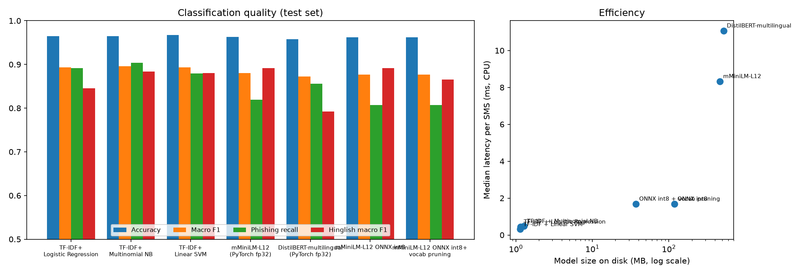
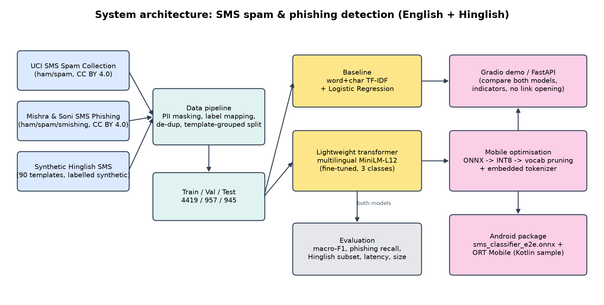
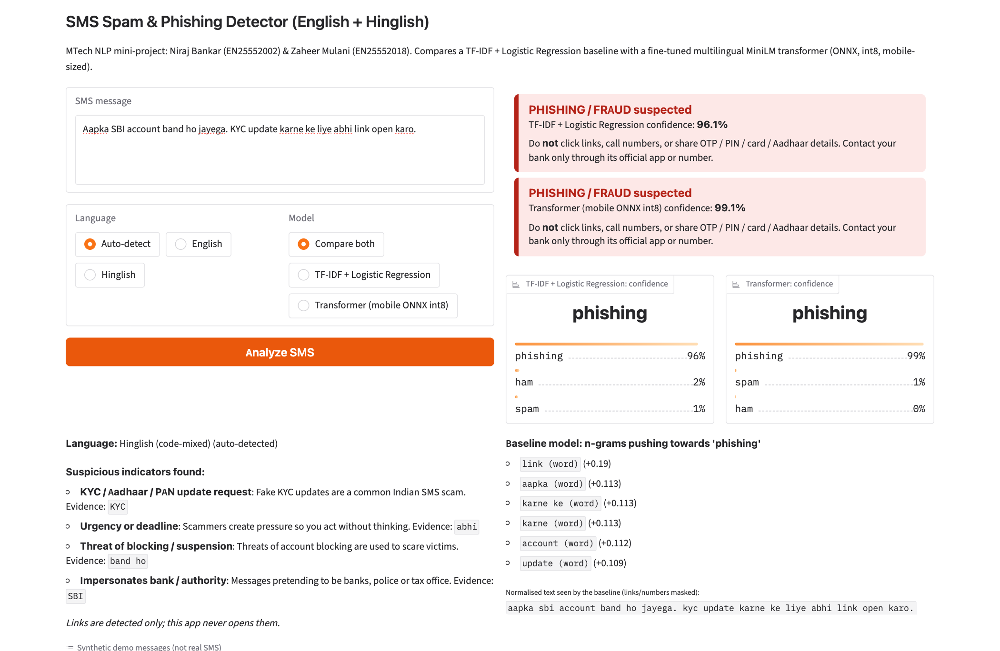
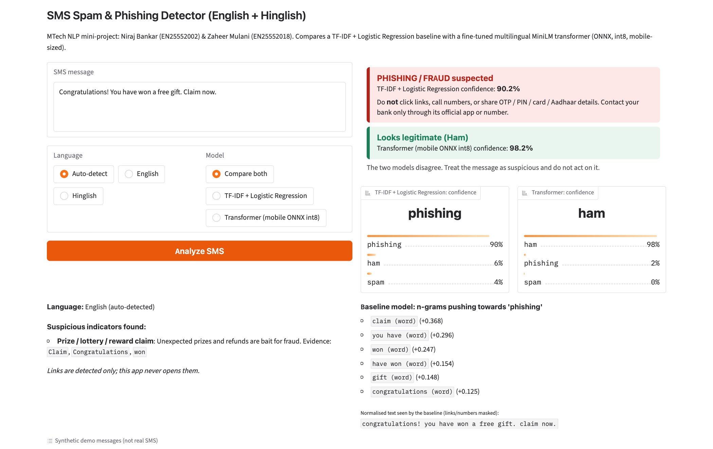

# SMS Spam & Phishing Detection (English + Hinglish)

**Detecting Spam and Phishing SMS Messages, Including Mixed Hindi-English (Hinglish) Text, Using
Classical Machine Learning and Lightweight Transformers**

MTech mini-project, Natural Language Processing.

| Team member | Roll No. | Main responsibility |
|---|---|---|
| Niraj Bankar | EN25552002 | data, preprocessing, classical baseline, evaluation |
| Zaheer Mulani | EN25552018 | transformer, mobile optimisation, Android package, demo |

See [docs/CONTRIBUTIONS.md](docs/CONTRIBUTIONS.md) for the full contribution matrix.

---

## Problem statement

SMS is still the channel that banks, couriers and OTP services rely on, which makes it the main
channel for *smishing* (SMS phishing). In India many scam messages are written in Hinglish
(Romanized Hindi mixed with English): *"Aapka SBI account band ho jayega. KYC update karne ke liye
abhi link open karo."* This project classifies a single SMS as **ham**, **spam** or **phishing**,
for both English and Hinglish, with a model small enough to run on a phone.

## Objectives

1. Build a 3-class dataset only from openly licensed sources, with documented label mapping, PII masking
   and leakage-safe splits.
2. Add a transparent, clearly labelled synthetic Hinglish supplement.
3. Classical baseline: word + character TF-IDF with Logistic Regression (plus Linear SVM and Naive Bayes).
4. Lightweight transformer: survey candidates, fine-tune multilingual MiniLM-L12 (and DistilBERT for comparison).
5. Compare all models on one held-out test set, emphasising phishing recall and a separate Hinglish evaluation.
6. Compress the transformer for mobile (ONNX, INT8, vocabulary pruning, embedded tokenizer) and verify it.
7. Interactive demo with confidence scores and suspicious-indicator explanations (links are never opened).

## Results (measured, test set of 945 messages)

| Metric | TF-IDF + Logistic Regression | MiniLM-L12 (PyTorch) | MiniLM-L12 mobile (ONNX INT8 + vocab pruning) |
|---|---|---|---|
| Accuracy | 0.9651 | 0.9630 | 0.9619 |
| Macro precision | 0.8892 | 0.8864 | 0.8880 |
| Macro recall | 0.8998 | 0.8738 | 0.8662 |
| **Macro F1** | **0.8937** | 0.8798 | 0.8765 |
| **Phishing recall** | **0.8916** | 0.8193 | 0.8072 |
| Phishing precision | 0.8132 | 0.8718 | **0.8816** |
| Phishing passed as ham (of 83) | 1 | 1 | 2 |
| Ham false-alarm rate | 1.16% | 0.51% | **0.39%** |
| ROC-AUC (macro, one-vs-rest) | 0.9904 | 0.9903 | 0.9905 |
| **Hinglish macro F1** (n = 50, unseen templates) | 0.8457 | **0.8915** | 0.8653 |
| Model size | **1.1 MB** | 465 MB | 37.2 MB (32.3 MB model + 4.8 MB tokenizer) |
| Median latency per SMS (CPU, batch 1) | **0.45 ms** | 8.33 ms | 1.69 ms |
| RAM increase after loading | 32.7 MB | 706 MB | 110 MB |
| Training time | 0.8 s (14 s grid search) | 277 s (Apple MPS) | n/a |

Full table with all 7 models (including Naive Bayes, Linear SVM and DistilBERT-multilingual):
[results/metrics/comparison_table.md](results/metrics/comparison_table.md).

**Findings.**
* The tuned TF-IDF baseline has the best macro-F1 and phishing recall on this (mostly English)
  test set. The transformer makes fewer false alarms, has higher phishing precision, and
  generalises better to Hinglish templates it has never seen.
* Most errors of both models are spam <-> phishing confusions that follow the noisy smishing labels
  of the source dataset. Only 1-2 of 83 phishing messages are passed as ham.
* Mobile optimisation shrinks the transformer about 14x (449 MB -> 32.3 MB) with 99.58% identical
  predictions on the test set.
* Lowering the phishing threshold (tuned on validation) helps only slightly
  ([results/metrics/threshold_tuning.json](results/metrics/threshold_tuning.json)).



## Datasets and licences

| Dataset | Labels | Licence | Obtained by |
|---|---|---|---|
| [UCI SMS Spam Collection](https://archive.ics.uci.edu/dataset/228/sms+spam+collection) (Almeida et al., 2011) | ham / spam | CC BY 4.0 | `src/data_loader.py` downloads it |
| [SMS Phishing Dataset](https://data.mendeley.com/datasets/f45bkkt8pr/1) (Mishra & Soni, 2022, doi:10.17632/f45bkkt8pr.1) | ham / spam / smishing | CC BY 4.0 | downloaded + SHA-256 verified |
| Synthetic Hinglish SMS (this project) | ham / spam / phishing | MIT | `src/hinglish_generator.py` (90 templates) |

* **Label mapping:** UCI spam is **not** relabelled as phishing by us. Phishing labels come from
  Mishra & Soni's author-assigned `smishing` label; original labels are kept (`label_uci`, `label_ms`).
* **Synthetic data:** the Hinglish messages are synthetic and every row says so (`source = synthetic_hinglish`).
  They use `.example` links and unallocated `+91 55555` numbers.
* **Privacy:** URLs, e-mails, phone numbers and 4+ digit runs are replaced by `<url>`, `<email>`,
  `<phone>` and `<num>` before data is saved, and a unit test checks this.

Details are in the data card: [data/README.md](data/README.md).

| Split | Total | ham | spam | phishing | of which Hinglish |
|---|---|---|---|---|---|
| train | 4,419 | 3,624 | 403 | 392 | 245 |
| val | 957 | 780 | 88 | 89 | 62 |
| test | 945 | 779 | 83 | 83 | 50 |

## System architecture



**Preprocessing.** Encoding repair, then PII masking, then label mapping, then de-duplication on the
masked text, then splitting (stratified for public data, by template for synthetic data).
* The classical branch also lower-cases, squashes repeated characters and normalises frequent
  Hinglish/SMS spellings (`nhi -> nahi`, `kro -> karo`, `u -> you`).
* The transformer branch keeps casing.
* No stemming or stop-word removal is applied, because words like "your", "abhi" and "karo" are phishing cues.

**Models.**
* *Baseline:* `FeatureUnion(word TF-IDF 1-2, char_wb TF-IDF 2-5)` + `LogisticRegression(class_weight="balanced")`,
  with C tuned by 5-fold CV.
* *Transformer:* `sentence-transformers/paraphrase-multilingual-MiniLM-L12-v2`.
  * Architecture: 12 layers, hidden size 384, XLM-R SentencePiece vocabulary.
  * Fine-tuning: class-weighted cross-entropy, lr 8e-5, max 128 tokens, early stopping on validation macro-F1.
  * Why this model: it was the fastest of four candidates in [src/model_selection.py](src/model_selection.py)
    and splits Hinglish words into the fewest pieces. It is not pre-trained on Romanized Hindi,
    so its Hinglish ability is measured, not assumed.

## Repository structure

```
sms-spam-phishing-detection/
├── app/                 app.py (Gradio demo), api.py (FastAPI)
├── data/                README.md (data card), hinglish/ (synthetic CSV), processed/ (masked splits), raw/ (downloaded, git-ignored)
├── deployment/          export_onnx.py, build_e2e_model.py, mobile_inference.py, android/ (Kotlin), README.md
├── docs/                report (.docx), presentation (.pptx), builders, diagrams/, screenshots/, VIVA_PREPARATION.md, CONTRIBUTIONS.md
├── models/              classical/ (joblib), transformer/ (fine-tuned, git-ignored), optimized/ (ONNX + tokenizer)
├── notebooks/           01_eda, 02_classical_ml, 03_transformer_training (executed), SMS_Phishing_Colab.ipynb
├── results/             metrics/ (JSON/CSV/MD), confusion_matrices/, graphs/
├── src/                 config, data_loader, hinglish_generator, preprocessing, eda, feature_extraction,
│                        train_classical, model_selection, train_transformer, evaluate, predict, explainability
├── tests/               test_preprocessing.py, test_prediction.py
├── tools/               notebooks, screenshots, pruning ablation, threshold tuning
├── requirements.txt  run_all.sh  LICENSE  README.md
```

## Installation

Python 3.10-3.12 (tested with 3.12). A GPU or Apple Silicon is used automatically if present, but
it is not required.

```bash
python -m venv .venv && source .venv/bin/activate      # Windows: .venv\Scripts\activate
pip install -r requirements.txt
pip install onnxruntime-extensions                       # only needed to build/verify the Android model
```

## Training and evaluation

```bash
bash run_all.sh            # everything below, in order
# or step by step:
python -m src.data_loader                 # download, mask, map labels, split
python -m src.eda                         # figures -> results/graphs
python -m src.train_classical             # TF-IDF + LR / SVM / NB
python -m src.model_selection             # transformer candidate survey
python -m src.train_transformer --model sentence-transformers/paraphrase-multilingual-MiniLM-L12-v2 --lr 8e-5
python -m deployment.export_onnx          # ONNX fp32 / int8 / pruned int8 + verification
python -m deployment.build_e2e_model      # single-file Android model + verification
python -m src.evaluate --reset --models logreg naive_bayes linear_svm transformer onnx_int8 onnx_pruned_int8
python -m pytest -q tests                 # 27 tests
```

**Google Colab:** open [notebooks/SMS_Phishing_Colab.ipynb](notebooks/SMS_Phishing_Colab.ipynb),
select a T4 GPU and run all cells. It clones the repo, trains, evaluates, rebuilds the report and
slides from *your* run, and starts the demo with a public link. GPU training is not bit-for-bit
reproducible, so expect small differences from the numbers above.

## Running the demo

```bash
python app/app.py              # http://127.0.0.1:7860
python app/app.py --share      # public gradio.live link (Colab / phone)
uvicorn app.api:app --port 8000   # optional REST API: POST /predict {"text": "...", "model": "onnx_pruned_int8"}
python -m src.predict --model logreg "Aapka SBI account band ho jayega. KYC update karo"
```

| Hinglish phishing | Prize message (the two models disagree) |
|---|---|
|  |  |

The screenshots are real captures of the running app (`tools/capture_screenshots.py`). The app
never opens links; links shown as evidence are defanged (`example[.]com`).

## Mobile deployment

| Variant | Size | Same label as PyTorch (945 test SMS) |
|---|---|---|
| PyTorch fp32 | 448.8 MB | (reference) |
| ONNX INT8 | 112.8 MB | 99.89% |
| ONNX INT8 + vocabulary pruning (25,103 of 250,037 rows) | 32.3 MB | 99.58% |
| `sms_classifier_e2e.onnx`: string in, logits out, tokenizer embedded | 37.2 MB | 100% identical to the pruned INT8 pipeline |

* The end-to-end model runs in ONNX Runtime + onnxruntime-extensions (the same ops shipped in the
  Android AAR): 1.7-2.4 ms per SMS on 1-4 desktop CPU threads, about 52 MB of session RAM.
* Kotlin integration: [deployment/android/SmsPhishingClassifier.kt](deployment/android/SmsPhishingClassifier.kt).
  **Status:** the ONNX models are verified on desktop; the Kotlin code has not been compiled or run
  on a physical Android device. See [deployment/README.md](deployment/README.md).

## Model artifacts

`models/transformer/` (about 1 GB) and the large ONNX variants are git-ignored. Recommended:

* commit `models/classical/*.joblib` (about 1 MB each), `models/optimized/model_pruned_int8.onnx`,
  `sms_classifier_e2e.onnx`, `sentencepiece.bpe.model` and `labels.json` with **Git LFS**, or
* attach `models/` as a ZIP to a **GitHub Release**. Anyone can also regenerate everything with
  `bash run_all.sh`.

## Limitations

* The Hinglish data is synthetic and the Hinglish test subset is small (50 messages from 14 unseen templates).
* The "phishing" class follows Mishra & Soni's broad smishing definition, which includes prize fraud,
  and the spam/smishing boundary is noisy.
* The public English data dates from 2011-2012, so modern UPI/KYC scams are covered mostly by the
  synthetic data.
* First names in public messages are not masked.
* There has been no on-device Android test.
* The language detector is a heuristic.

## Future scope

* Consented real Hinglish SMS collection.
* URL reputation and sender-ID features.
* Re-annotation of the spam/smishing boundary.
* A baseline + transformer ensemble.
* Hinglish-pre-trained compact models.
* On-device benchmarks.
* Devanagari and other Indian languages.

## Git: uploading to your repository

The project folder has not been put under version control or pushed anywhere; that is for you to
do, so the history reflects your own work. Create an **empty** repository on GitHub (no README),
then:

```bash
cd sms-spam-phishing-detection
git init
git lfs install                                   # optional, for model files
git lfs track "models/optimized/*.onnx" "models/classical/*.joblib"
git add .gitattributes .gitignore LICENSE README.md requirements.txt run_all.sh
git commit -m "Initial project setup"
git branch -M main
git remote add origin https://github.com/<your-username>/sms-spam-phishing-detection.git
git push -u origin main
```

Suggested commit sequence, with each member committing the modules they own (see CONTRIBUTIONS.md):

| # | Commit | Files | Owner |
|---|---|---|---|
| 1 | Initial project setup | README, requirements, .gitignore, LICENSE, src/config.py | both |
| 2 | Dataset acquisition and preprocessing | src/data_loader.py, src/hinglish_generator.py, src/preprocessing.py, data/ | Niraj |
| 3 | Exploratory data analysis | src/eda.py, notebooks/01_eda.ipynb, results/graphs/0* | Niraj |
| 4 | Classical ML implementation | src/feature_extraction.py, src/train_classical.py, notebooks/02_* | Niraj |
| 5 | Transformer implementation | src/model_selection.py, src/train_transformer.py, notebooks/03_* | Zaheer |
| 6 | Model evaluation and comparison | src/evaluate.py, src/predict.py, src/explainability.py, results/ | Niraj |
| 7 | Model optimisation and ONNX export | deployment/, tools/pruning_ablation.py | Zaheer |
| 8 | Demo application | app/, tools/capture_screenshots.py, docs/screenshots | Zaheer |
| 9 | Documentation and report | docs/, tests/, notebooks/SMS_Phishing_Colab.ipynb | both |
| 10 | Final project release | tag `v1.0`, attach models as a GitHub Release | both |

```bash
git add src/data_loader.py src/hinglish_generator.py src/preprocessing.py data/README.md data/hinglish data/processed
git commit -m "Dataset acquisition, PII masking and preprocessing"
# ... repeat per row above ...
git tag v1.0 && git push --tags
```

## References

1. T. A. Almeida, J. M. G. Hidalgo, A. Yamakami, "Contributions to the study of SMS spam filtering: new collection and results," ACM DocEng, 2011.
2. S. Mishra, D. Soni, "SMS Phishing Dataset for Machine Learning and Pattern Recognition," Mendeley Data, V1, 2022, doi:10.17632/f45bkkt8pr.1.
3. S. Mishra, D. Soni, "Smishing Detector: A security model to detect smishing through SMS content analysis and URL behavior analysis," Future Generation Computer Systems, 108, 2020.
4. W. Wang et al., "MiniLM: Deep self-attention distillation for task-agnostic compression of pre-trained transformers," NeurIPS, 2020.
5. N. Reimers, I. Gurevych, "Making monolingual sentence embeddings multilingual using knowledge distillation," EMNLP, 2020.
6. A. Conneau et al., "Unsupervised cross-lingual representation learning at scale," ACL, 2020.
7. V. Sanh et al., "DistilBERT, a distilled version of BERT," arXiv:1910.01108, 2019.
8. R. Nayak, R. Joshi, "L3Cube-HingCorpus and HingBERT," WILDRE @ LREC, 2022.
9. B. Jacob et al., "Quantization and training of neural networks for efficient integer-arithmetic-only inference," CVPR, 2018.
10. ONNX Runtime, https://onnxruntime.ai; scikit-learn (Pedregosa et al., JMLR 2011); Hugging Face Transformers (Wolf et al., EMNLP 2020); PyTorch (Paszke et al., NeurIPS 2019); Gradio.

The full IEEE-style list is in the project report.

*AI assistance: an AI coding assistant (Claude) was used to help draft code and documentation. All
experiments were run with the code in this repository, and all reported numbers come from
`results/metrics/`.*
